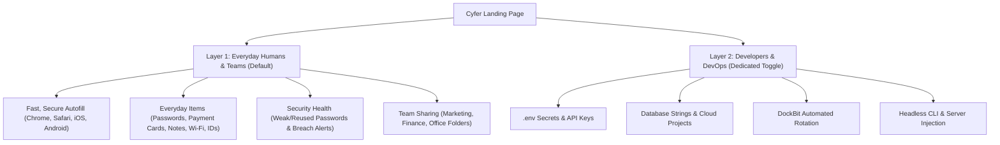

# Plan: Cyfer Home Page Transformation (Marketing & Plain English)

## Objective
Transform the **Cyfer** home page from a developer-jargon-heavy engineering specification into an engaging, clear, high-converting marketing landing page. A normal user (individual, family, or business team manager) with zero coding knowledge should immediately understand what Cyfer is, why it is safer, and how it simplifies their daily life—while developer features remain cleanly accessible without overwhelming non-technical visitors.

---

## 1. Core Marketing Strategy & Messaging Hierarchy

### Key Editorial Rules
1. **Plain English First**: Replace engineering terms with clear human benefits.
2. **Never Dump Backend Architecture on the Marketing Page**: Move internal implementation details (*Argon2id Wasm memory costs, HKDF-SHA256, Ed25519 signatures, PostgreSQL advisory locks, Docker compose.yaml, k-anonymity math*) to the `/security` technical paper.
3. **Show Familiar Accounts in Mockups**: Swap `AWS Production Console` and `DATABASE_URL` with accounts people recognize: **Google Workspace, Stripe, Canva, Netflix, Bank, Wi-Fi**.

---

## 2. Section-by-Section Transformation (Home Page Only)

### Section 1: Hero (`components/home/Hero.tsx`)
- **Headline**: Change from *"The vault for people who ship."* $\rightarrow$
  > **"Every password, card, and private note.**  
  > **One calm, secure vault."**
- **Subtitle**: Change from *"Logins, API keys, env files and servers..."* $\rightarrow$
  > *"Save, autofill, and share your logins, payment details, and private notes seamlessly across all your devices. Encrypted on your device—completely invisible to everyone else, even us."*
- **Hero Badges**:
  - Remove: `WebCrypto Argon2id + AES-256`, `0 Unencrypted Bytes Transmitted`.
  - Add: `✓ Zero-Knowledge Security` · `✓ Built-in 2-Step Verification` · `✓ Instant Autofill Everywhere`.
- **Audience Mode Switcher**:
  - Keep the dual toggle, but rename cleanly:
    - **`For Everyday & Teams`** (selected by default)
    - **`For Developers & Code`**
- **App Mockup**:
  - Show a familiar item: **Google Workspace** or **Stripe Dashboard** login with live 30s 2FA countdown code.
  - Action button: **"Autofill Login"** or **"Copy 2FA Code"**.

---

### Section 2: Proof Strip (`components/home/ProofStrip.tsx`)
Replace obscure engineering metrics with relatable benefits:

| Current Tech Jargon | New Human-Friendly Copy |
| :--- | :--- |
| `11 Dedicated Item Types` | **11 Purpose-Built Items**: Dedicated templates for passwords, credit cards, Wi-Fi, and notes. |
| `0 Unencrypted Bytes to Server` | **100% Private**: Your master password never leaves your phone or computer. |
| `5 Hash Chars (k-anonymity)` | **Breach Monitoring**: Instant alerts if your accounts appear in public data leaks. |
| `100% Device-Side Key Derivation (RAM)` | **Works Everywhere**: Chrome, Safari, Edge, iOS, and Android with biometric Face ID unlock. |

---

### Section 3: 11 Item Types (`components/home/ElevenItemTypes.tsx`)
- **Grouped Layout**:
  - **Category A: Everyday Essentials (Lead First)**:
    1. **Logins & Passwords** (with built-in 2FA verification codes)
    2. **Payment Cards** (safe autofill on checkout pages)
    3. **Secure Notes** (private memos, passport numbers, pin codes)
    4. **Personal Identities** (addresses, tax IDs, shipping info)
    5. **Wi-Fi Passwords** (easy sharing with guests)
    6. **Passkeys** (instant biometric sign-in without typing passwords)
  - **Category B: Developer & Cloud Secrets (Clean Tab)**:
    7. **Env / Secrets** (.env files and configuration keys)
    8. **API Keys** (third-party service tokens with rotation)
    9. **SSH Keys** (server access keys)
    10. **Database Connections** (Postgres, MySQL, Redis connection strings)
    11. **Cloud Projects** (Supabase, Firebase, Neon bundles)
- **Interactive Simulator**:
  - Remove mandatory `.env` code input (`SUPABASE_URL=...`).
  - Provide a toggle between **"Try a Payment Card Autofill"** and **"Try a Developer .env File"**.

---

### Section 4: Vault Health (`components/home/HealthSection.tsx`)
- **Remove**: Network subnet splitting (`Internet vs Local LAN 192.168.1.1`), `k-anonymity`.
- **Refocus on 4 Clear Health Checks**:
  1. **Weak Passwords**: Identifies short or easily guessed passwords.
  2. **Reused Passwords**: Spots passwords used across multiple sites so one breach doesn't compromise others.
  3. **Data Leak Alerts**: Checks if any credentials appear in known company data breaches.
  4. **Missing 2FA**: Highlights accounts that need 2-step verification turned on.

---

### Section 5: Password Rotation (`components/home/RotationSection.tsx`)
- **Remove**: "DockBit Automated Rotation 30-365 days".
- **Refocus**:
  - **"Never let important passwords go stale."**
  - Explain gentle reminders: Cyfer flags accounts that haven't been updated in over 90 days.
  - Mention automated rotation for connected business integrations as an advanced feature.

---

### Section 6: Connected Apps & Devices (`components/home/ConnectedAppsSection.tsx`)
- **Remove**: "Ed25519 Signed Server Requests", "CLI Tokens", "0600 file caches".
- **Refocus**:
  - **"Seamless access across all your apps and devices."**
  - Highlight browser extensions (Chrome, Safari, Firefox, Edge) and mobile apps (iOS, Android).
  - Add a sub-card showing that technical teams can also inject secrets into scripts and build pipelines.

---

### Section 7: Sage Assistant (`components/home/SageAssistantSection.tsx`)
- **Remove**: `{{v1}} regex masking`, `Claude 3.5 Haiku / MiniMax`, `$4/mo budget cap`, `HMAC cache`.
- **Refocus**:
  - **"An intelligent assistant that keeps your vault tidy—without ever reading your passwords."**
  - Three simple abilities:
    1. Organize tags and sort folders automatically.
    2. Clean up duplicate or old accounts.
    3. Spot weak credentials and guide you to fix them.
  - Clear guarantee: *"Sage only reads item titles and tags; your actual passwords and private notes are never sent to any AI model."*

---

### Section 8: Teams & Organizations (`components/home/TeamsSection.tsx`)
- **Remove**: "Bastion SSH Keys", "Shared DB Connection Strings", "Tamper-evident hash chain", "RSA Re-wrapped".
- **Replace with Real Office Folders**:
  - `Marketing & Social` (Instagram, LinkedIn, Canva, Buffer)
  - `Finance & Billing` (Stripe, Xero, Company Cards)
  - `Engineering & Tech` (AWS, GitHub, Staging Servers)
- **Activity Log**:
  - Change raw JSON/hash logs to plain English actions:
    - *"Sarah updated the Canva Pro password (2 mins ago)"*
    - *"Alex viewed Office Wi-Fi credentials (15 mins ago)"*
    - *"Devon added a new client billing card (1 hour ago)"*

---

### Section 9: Security Promise (`components/home/SecurityPromiseSection.tsx`)
- **Remove**: Academic math explanations (*Argon2id 64MB memory cost, 130-bit uniform entropy, 3-node network diagram*).
- **Replace with 3 Concrete Reassurances**:
  1. **Zero-Knowledge Architecture**: Everything is locked on your device before syncing. Even if Cyfer's servers were breached, attackers only see scrambled ciphertext.
  2. **No Password Reset Backdoors**: We cannot reset your vault because we don't hold your key. You receive a printable emergency recovery kit.
  3. **Biometric & Passkey Ready**: Unlock instantly with Touch ID, Face ID, or Windows Hello.

---

### Section 10: Pricing Teaser (`components/home/PricingTeaserSection.tsx`)
- Keep the clear Australian dollar pricing ($0 Free Personal, $4/mo Team, Enterprise).
- Remove references to `Docker compose.yaml` from the main card subtitle; label it cleanly: **Free Personal Vault (Cloud or Self-Hosted)**.
- Reassure users with the **Read-Only Grace Guarantee**: If you ever cancel, you never lose access to your data.

---

## 3. Implementation Steps & Verification

1. **Update Hero Section**: Revise copy, badges, and mockup accounts in `components/home/Hero.tsx`.
2. **Update Proof Strip**: Replace engineering stats with relatable user benefits in `components/home/ProofStrip.tsx`.
3. **Reorganize 11 Item Types**: Reorder cards to lead with everyday items in `components/home/ElevenItemTypes.tsx`.
4. **Simplify Health Section**: Remove LAN/subnet jargon in `components/home/HealthSection.tsx`.
5. **Streamline Rotation & Connected Apps**: Rewrite to focus on reminders and browser extensions in `components/home/RotationSection.tsx` and `components/home/ConnectedAppsSection.tsx`.
6. **Rewrite Sage & Teams Sections**: Use real human office examples in `components/home/SageAssistantSection.tsx` and `components/home/TeamsSection.tsx`.
7. **Refactor Security Promise**: Focus on user reassurance in `components/home/SecurityPromiseSection.tsx`.
8. **Verify & Review**:
   - Run `npm run build` to confirm 100% error-free static compilation.
   - Capture Google Chrome headless screenshots in both Light and Dark modes.
   - Verify readability and high visual contrast.
